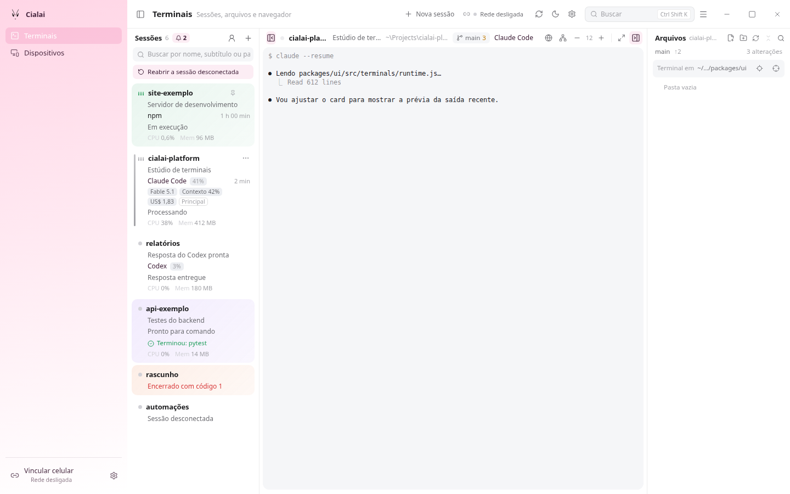
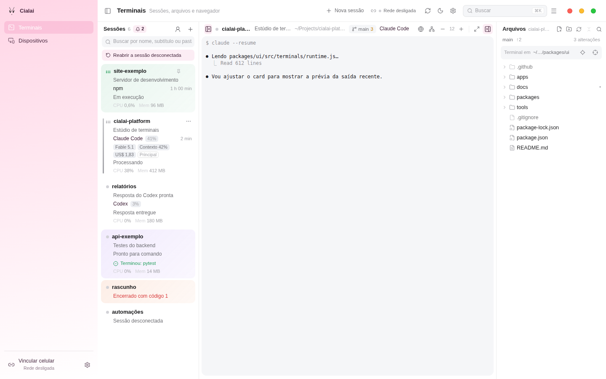

# Controles da janela na toolbar

Implementação: 06/10/2026. Atualização sobre a main 0.2.12: 15/10/2026.

Busca, menu da aplicação e controles da janela passam a ocupar a mesma barra
de 52 px no desktop. O macOS mantém Overlay e a menubar nativa, com os botões
originais ocultos e controles coloridos na toolbar; o verde alterna tela cheia.
O Linux passa a usar janela sem barra de título e oito áreas para iniciar o
redimensionamento pelo compositor. O Windows reaproveita seus controles.

## Verificação automatizada

| Verificação | Resultado e limite |
| --- | --- |
| Build de interface | `npm run build:ui --workspace @cialai/desktop` aprovado, incluindo o recurso móvel |
| Contrato de janela e scaffold | `npm run check:window` e `node tools/check/desktop-scaffold.mjs` aprovados; conferem configurações, permissões e recuperação preparada |
| CSS | `npm run check:platform-css` e `npm run check:css-cascade` aprovados |
| Interface e idiomas | `npm run test:ui`, `npm run test:i18n`, `npm run check:text` e `npm run check:native-i18n` aprovados |
| Geometria da toolbar | Três cenários de Chromium sobre o build de produção aprovados: macOS, Windows e Linux simulados; cada um mede 12 combinações de tema, largura e sidebar, totalizando 36 layouts |
| Interações da toolbar | Busca e menu abrem e fecham nos 36 layouts; cliques nos controles e início de resize são conferidos por uma ponte Tauri simulada, sem janela nativa |
| Inspeção visual inicial | Seis capturas com dados fictícios em 06/10, nos três sistemas simulados, a 1440 px no claro e 880 px no escuro; Mac claro e Linux estreito conferidos visualmente. Esses artefatos ficaram fora do Git |
| Rust | Formatação aprovada; compilação da biblioteca e 13 testes `window::tests` aprovados no Ubuntu 22.04 x86_64 em contêiner, sem abrir a interface nativa |

Os cenários da toolbar estão em `tools/browser/check-window-toolbar.mjs`,
integrados ao `npm run test:browser`. Medem ordem busca, menu e controles,
altura, alinhamento, ausência do espaçador antigo e contenção dos botões na
toolbar. O contêiner Rust usa dependências GTK e WebKitGTK isoladas; os
recursos de túnel e Tor são excluídos apenas da configuração desse teste.
O comando foi `cargo test --manifest-path apps/desktop/src-tauri/Cargo.toml
--locked --offline --lib window::tests -j 2`, com a configuração temporária
`TAURI_CONFIG={"bundle":{"externalBin":[],"resources":null}}`, perfil sem
informações de debug, dois CPUs e limite de memória de 4 GiB. A biblioteca
compilou em 5 min 51 s; os 13 casos passaram, com 413 casos fora do filtro.
Isso não valida instaladores, sidecar, Tor nem a interação com janelas reais.

## Atualização de 15/10/2026

A branch foi reaplicada sem conflitos sobre `3ba0dc0`, main na versão 0.2.12.
O `npm run test:browser` passou nos oito cenários de Chromium, cinco sobre o
build de produção. Inclui as 36 combinações da toolbar e os fluxos existentes
de desktop, rede, terminal móvel e geometria de diálogos.

O build desktop, o recurso móvel, `cargo fmt --check`, Clippy com
`--all-targets -- -D warnings` e os testes Rust completos passaram em
Ubuntu 22.04 x86_64 em contêiner: 424 aprovados e quatro ignorados pela suíte.
O contêiner precisa de `docker run --init` para coletar descendentes órfãos:
a primeira execução sem init falhou em três testes de encerramento da árvore
do sidecar; os mesmos testes passaram com init. Nenhuma alteração no código
de encerramento foi necessária. Ao contrário do teste filtrado de 06/10,
essa execução inclui build do sidecar e staging dos recursos Tor, sem
sobrescrever a configuração Tauri.

A execução de `npm test` chegou até a etapa móvel: todos os checks anteriores,
incluindo `go vet ./...` e `go test -mod=readonly ./...`, passaram. O Jest
móvel terminou com 30 suítes aprovadas, uma reprovada, 351 testes aprovados
e um timeout de 5 s em `Pair explains the QR flow, camera use and a pairing
notice`. A repetição isolada por `npm run test:mobile` fora do contêiner
teve o mesmo resultado. A suíte completa, portanto, não está aprovada.
Os arquivos de `apps/mobile` e o lockfile não foram alterados nesta branch.
O teste isolado também falhou pelo mesmo timeout em um worktree limpo da
main `3ba0dc0`, usando `jest --runInBand --runTestsByPath
src/screens/screens.test.js --testNamePattern '^Pair explains the QR flow,
camera use and a pairing notice$'` no workspace móvel. A falha foi, assim,
reproduzida na base, sem os controles de janela desta alteração.

As capturas abaixo mostram o build de produção atualizado em 1440 × 900,
com tema claro, dados fictícios e o sistema simulado por parâmetro. Não são
capturas do protótipo interno nem comprovam comportamento nativo.

| Linux | Windows | macOS |
| --- | --- | --- |
|  |  |  |

## Aceite nativo pendente

Em 15/10, uma prévia nativa Linux/X11 foi aberta em contêiner com a identidade
do usuário da sessão e visualizada pelo solicitante. Essa conferência é
limitada à prévia; não completa o roteiro de aceite. Não houve nova execução
nativa em macOS, Windows ou Wayland para esta alteração.
Tela cheia do AppKit, minimizar, maximizar, mover,
redimensionar, confirmação de saída e recuperação visual precisam do
[roteiro de execução](../../testes/roteiro-barra-da-janela.md). As evidências
anteriores do roadmap permanecem históricas e não aprovam estes novos controles.
