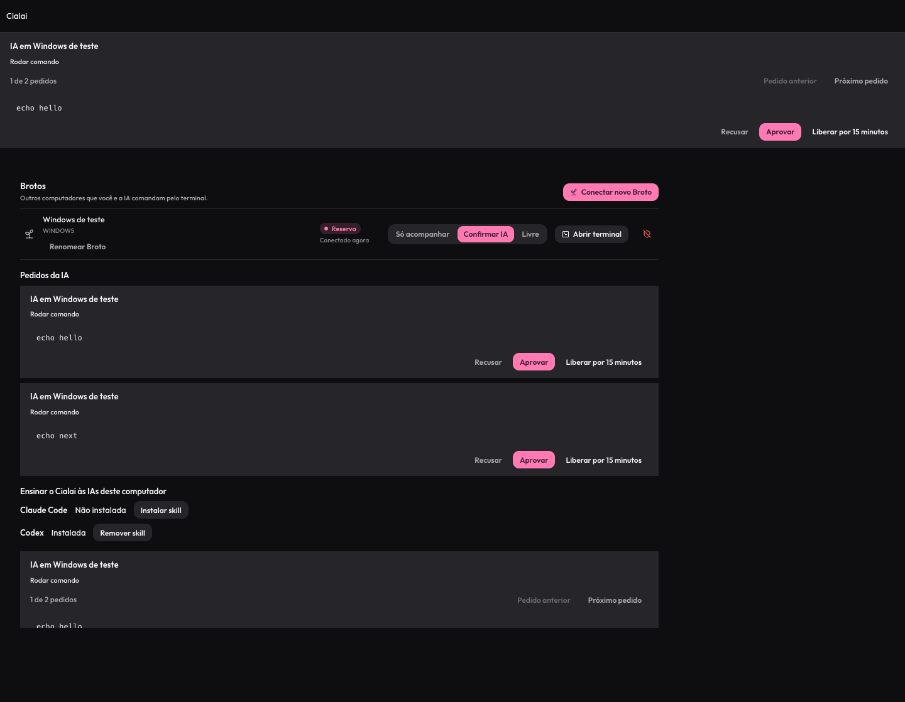
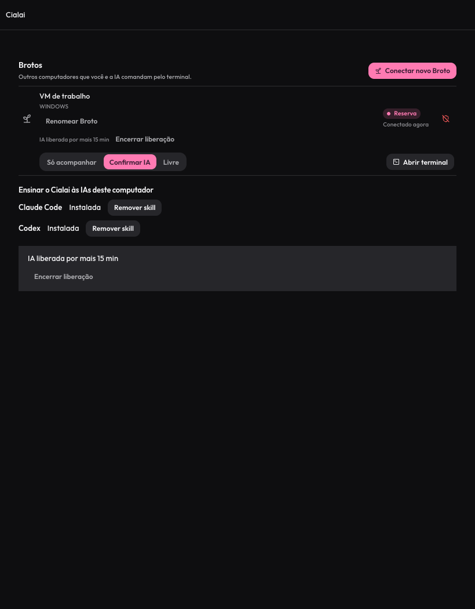
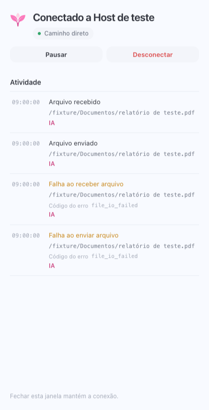

# IA no comando dos Brotos

Validação local de 28/10/2026, referente a [BRO-014 a BRO-022](../../broto/09-ia-no-comando.md). Sem commit, publicação ou mudança na instalação pareada existente.

## Implementação exercitada

A rodada inicial passou nas suítes disponíveis, mas não cobria os defeitos identificados na revisão posterior. As correções e regressões dessa revisão estão registradas ao fim deste documento.

- CLI com seleção por número, nome, prefixo e ID, shell por plataforma, programa direto, terminais, leitura sem ANSI, códigos de saída e arquivos.
- IPC privado impondo autor IA, fluxo maior que 4 MiB em vários quadros e cancelamento do handler quando o cliente encerra a conexão.
- CLI integrada ao hub, fio RPC e executor reais, com espera por aprovação e saída em fluxo.
- Transferência local de 104857600 bytes por blocos. Envio e download produziram SHA256 `122921bf96749ccbe330a032072c597559a5840f7a6c9471ca1417f337b73ccc`.
- Recusa de sobrescrita, integridade de bloco e arquivo, confinamento, cancelamento, pausa e permissões cobertos pelos testes Go.
- Sessão IA em memória, cancelamento, wrappers v2 e instalação gerenciada de skill cobertos pelos testes Rust. Os wrappers POSIX foram executados com argumentos contendo espaços e metacaracteres; o Windows foi conferido pela geração, sem execução de cmd nesta rodada.
- Paridade MCP coberta pela suíte do servidor e pela implementação compartilhada de transferência.

## Interface

`tools/broto/check-ai-ui.mjs` renderiza componentes React reais com uma fronteira nativa simulada. O teste verifica um pedido por Broto em cada superfície, remoção sincronizada após decisão, liberação temporária, renomeação, instalação da skill, posicionamento abaixo da barra da janela e ausência de transbordamento horizontal em 820 pixels. Nenhuma skill foi instalada no perfil pessoal por esse teste.

As capturas foram inspecionadas visualmente. São dados fictícios de teste, sem captura do protótipo ou de conteúdo pessoal.





## Reprodução

Use o ambiente de build do projeto e cache em disco apropriado.

```sh
cd packages/tunnel-core
go test -race ./internal/pairing ./internal/brotoexec ./internal/brotorpc ./internal/brotocli ./internal/brotohostipc ./internal/brotomcp ./internal/brotoclient ./internal/sidecar ./cmd/cialai-tunnel
CIALAI_BROTO_LARGE_FILE_TEST=1 go test ./internal/brotocli -run TestLargeFileRoundTrip -v
```

O teste de 100 MiB é opt-in e cria arquivos temporários. Use `TMPDIR` no disco de build. A fixture visual aceita `BROTO_UI_BROWSER` para um Chromium instalado ou usa o navegador do Playwright.

## Limites reais

A transferência de 100 MiB acima usa CLI e executor no mesmo computador. Não é prova de transferência entre Mac e Windows. O teste de interface usa o limite nativo simulado e não substitui acompanhamento de uma sessão remota no app instalado.

Permanecem pendentes as provas de Claude Code sem MCP, descoberta automática da skill numa sessão nova, transferência entre Mac e Broto Windows, acompanhamento e Ctrl C no card real, e o aceite conjunto com dois Brotos. A tentativa de iniciar a VM Windows por UTM retornou OSStatus -10004; outra tentativa não concluiu e a VM permaneceu parada. Os cinco pacotes de teste foram compilados para Windows amd64, o que não equivale à execução no Windows.

Os logs integrais e o histórico de diagnóstico permanecem nas notas internas ignoradas pelo Git.

## Resultados da rodada inicial

| Validação | Resultado |
| --- | --- |
| `npm test` com Node 22 e sem variáveis de perfil herdadas | Passou integralmente |
| Rust | 491 testes passaram, 8 ignorados |
| Interface | 461 testes passaram, além de 41 verificações legadas |
| Mobile | 372 testes passaram em 33 suítes |
| Protocolo e i18n | 22 testes de protocolo e 4 de i18n passaram |
| Go com `-race` nos nove pacotes alterados | Passou |
| 100 MiB após revisão do download | Envio e download passaram com tamanho e SHA256 conferidos |
| Linux amd64 em VM QEMU, conta UID 1000 | Cinco pacotes passaram: executor, hub, CLI, IPC e MCP |
| Windows amd64 | Cinco pacotes compilaram; execução não realizada |
| Playwright | Aprovações, liberação, renomeação, skill e geometria passaram |
| Catálogo nativo, texto visível e whitespace | Passaram |

A VM Linux usou rootfs efêmero e desligou ao terminar. Duas falhas de infraestrutura do runner foram corrigidas antes da execução aprovada: permissão de escrita em `/tmp` e ausência de entropia no boot mínimo. O teste grande não foi executado dentro dessa VM; a prova de 100 MiB continua sendo local no Mac.

A primeira suíte Rust herdou variáveis de perfil e falhou num teste preexistente do menu de agentes. O teste isolado e a suíte completa passaram após remover essas variáveis do processo de teste, sem alterar perfis pessoais.

## Correções após revisão

As reproduções abaixo falharam antes da correção. O estado anterior não deve ser usado como prova de que esses comportamentos já estavam corretos.

| Problema | Correção e verificação |
| --- | --- |
| Fechar card cancelava comandos | `closing_ai_card_hides_without_cancelling_and_next_command_reopens`; fechar oculta, Ctrl C continua cancelando |
| Saída Unix em escada | `ai_output_normalizes_lf_without_doubling_crlf_across_frames`; LF vira CRLF sem duplicar CR entre blocos |
| Invocação interna e milissegundos no card | `ai_card_shows_original_shell_line_and_seconds`; reconhece a invocação do shell e mostra a linha original e segundos |
| Leitor lento travava a RPC | `TestSlowExecSubscriberDoesNotBlockOtherCalls`, com consumidor IPC e evento global; outras chamadas continuam respondendo |
| Consumidor excede o buffer | `TestExecOutputOverflowCancelsOnlyItsCall`; falha explícita `output_backpressure`, sem derrubar o aparelho |
| Resposta final antes de drenar a saída | `TestFullOutputQueueDrainsBeforeSuccessfulFinalResponse`, incluindo fila cheia e 33 saídas |
| Escrita IPC retida após cancelamento | `TestStalledEventReaderDoesNotHoldCancelledHandler`; fechar o contexto desbloqueia o escritor |
| Recebimento abandonado ou processo encerrado | `TestAbandonedUploadExpiresWithoutFurtherRequests` e `TestUploadLockSurvivesLiveOwnerAndRecoversAfterCrash`; expiração automática e bloqueio entre processos |
| Arquivos acessíveis em conta privilegiada | `TestFilesPrivilegedAccountGuard`, cobrindo os cinco verbos |
| Erros de arquivo indistinguíveis | `TestFileDiagnosticsAreActionableAndSanitized`; motivos específicos sem expor conteúdo ou caminho em mensagens de erro |
| Ordem dos pedidos instável | `TestPendingApprovalsAreOldestFirst`; interface mantém seleção por ID |
| Fila sem navegação e lista ausente | Testes Node e Playwright verificam contador, navegação sincronizada e todos os pedidos em Dispositivos |
| Skill compartilhada por symlink | `shared_alias_removal_requires_explicit_shared_intent`; exclusão exige ação explícita para ambas as IAs e preserva aliases |
| Fixture dependente do idioma do navegador | Falha original reproduzida em inglês; fixture agora roda inglês, português e espanhol com rótulos do catálogo |

`npm test` agora inclui `test:broto-ui`. A matriz CI instala Playwright antes da suíte nos três sistemas. A fixture também verifica o botão explícito de remoção compartilhada. Os casos de execução Windows estão em `test:broto-command-windows`; fora do Windows, o comando informa SKIP, sem contabilizar aprovação.

O bloqueio vazio `.cialai-part.lock` permanece no destino para manter a identidade do bloqueio entre processos. O sistema libera o bloqueio quando o dono encerra. Um parcial órfão só é reaproveitado após obter exclusividade; um envio vivo continua protegido. A inatividade de um recebimento por quinze minutos remove o parcial automaticamente.

### Limite do wrapper Windows

Foram ajustados delayed expansion e escape de porcentagem no caminho do sidecar, mas isso não comprova que `%*` preserve argumentos arbitrários. O teste nativo compara o wrapper com o executável direto e inclui um sentinel para detectar execução local indevida. A VM continuou parada após OSStatus -10004; essa prova permanece aberta. Não há declaração de segurança ou aceite do repasse Windows nesta revisão.

## Resultado da revisão

- `npm test` passou com o teste visual integrado: 496 testes Rust, 8 ignorados, 464 testes de interface nessa execução, 372 móveis, 22 de protocolo e 4 de i18n.
- Após o ajuste final da atividade de arquivos, a suíte da interface foi repetida e passou com 476 testes. Doze casos renderizam o JSX real para envio e download, sucesso e falha, nos três idiomas, conferindo caminho escapado e ausência de conteúdo do arquivo.
- Os nove pacotes Go passaram com `-race`. Os cinco pacotes da VM Linux foram executados novamente e passaram; a VM desligou ao terminar.
- O envio e download local de 100 MiB foi repetido com tamanho e SHA256 iguais.
- Catálogo nativo, texto visível, i18n, matriz CI e `git diff --check` passaram.
- O teste Windows informou SKIP no Mac. Nenhuma execução nativa de `%*` foi contabilizada como sucesso.



## Retomada das correções do ensaio MCP de 28/10/2026

Revisão concluída em 29/10/2026 sobre as alterações locais preservadas na branch. Os seis relatos foram confirmados por reproduções e inspeção do código. O comportamento e os limites ficam nos documentos de cada assunto:

| Tema | Evidência e contrato |
| --- | --- |
| Configuração do IPC | Testes Unix recusam pai simbólico, escrita de grupo e escrita de outros, com caminho e causa. O MCP recompilado foi chamado por stdio e apresentou esses erros antes de procurar o socket ausente. A falha aparece em `diagnostics.run`, com rótulo nos três idiomas; [seleção e diagnóstico](../../broto/06-mcp.md#instância-do-hospedeiro-e-diagnóstico-do-ipc) |
| Instâncias separadas | Dois estados alcançaram seus próprios hospedeiros em testes com listeners reais no Mac e no Windows. Testes cobrem o padrão da instalação, override explícito, caixa de caminho Windows e limite em bytes do socket; [segurança](../../broto/04-seguranca.md#ipc-do-hospedeiro-e-isolamento-de-instâncias) |
| Sessão gráfica | Nova chamada MCP pela conta comum confirmou processo na Session 0 e console na sessão 1. Nenhum app gráfico foi iniciado; [limitação e proposta](../../broto/06-mcp.md#aplicativos-gráficos-no-windows) |
| UTF-8 no Windows | Binário de testes executado pela ponte na conta comum e Session 0: stdout, stderr, acentos, CJK, emoji, script com argumentos e código de saída, ConPTY com leituras de um byte, prazos, Ctrl C e encerramento da árvore; [codificação e limites](../../broto/03-controle.md#codificação-no-windows) |
| Polling no log | Teste com logger real confirma consultas fora de info e presença em debug, preservando `exec`, `pty.open` e `pty.write` em info; [log operacional](../../broto/03-controle.md#log-operacional-do-hospedeiro) |
| Prazos e eco | Regressões MCP conferem descrições, prazos e offsets; o ensaio anterior reproduziu casamento com eco usando `rem`. O adaptador novo também expôs as descrições por stdio; [contrato de espera](../../broto/06-mcp.md#prazos-e-eco-do-terminal) |

A primeira repetição Windows encontrou Ctrl C sem efeito na conta comum. O teste falhou cinco vezes antes da correção. A opção herdada de ignorar Ctrl C foi limpa no auxiliar do PTY, com handler próprio instalado antes dessa limpeza. Um teste adicional reproduz a herança criando um grupo de processos separado e também falhou com o código anterior. Isso acrescenta cobertura ao teste anterior executado em outro contexto de conta.

| Validação desta retomada | Resultado |
| --- | --- |
| `TMPDIR=/tmp go test -race -p 1 -count=1 ./...` | Todos os pacotes passaram; fixtures de sockets do hospedeiro e dos testes de controle usam pastas privadas na pasta pessoal |
| Suíte Rust do desktop com `cargo test --locked`, sem perfis de agente herdados | 497 passaram, 8 ignorados |
| Suíte da interface | 477 passaram |
| i18n, texto visível e documentação viva | Passaram |
| Executor nativo Windows pela conta comum | 12 passaram; 1 teste que exige conta elevada foi ignorado, sem contabilizar essa guarda como prova nova |
| IPC nativo Windows pela conta comum | 8 passaram; 1 teste de permissões Unix foi ignorado |
| `go vet` para os pacotes Windows alterados e `git diff --check` | Passaram |

Os logs integrais, hashes dos binários de teste e roteiros ficam nas notas internas ignoradas pelo Git. O serviço Windows, o binário MCP do ensaio original e o Cialai Teste aberto não foram substituídos ou reiniciados. A validação usa binários separados. O watcher de desenvolvimento permaneceu pausado como estava na retomada, para não reiniciar o app durante a edição. A adoção das correções na instalação aberta requer uma atualização posterior autorizada; esta rodada não comprova o diagnóstico novo renderizado naquela janela antiga.

As propostas 069 e 070 permanecem sem decisão e sem implementação. Nenhuma tarefa agendada virou lançador oficial e nenhum filtro de eco foi adicionado. As pendências de BRO-022 continuam abertas.


## Preparação da prévia 0.5.0 do hospedeiro e 0.1.0 do Broto

Em 29/10/2026, o teste nativo do comando Windows reproduziu interpretação local de operadores na segunda leitura do `.cmd`. Esse repasse foi substituído por `cialai.exe`, um lançador nativo embutido no hospedeiro, com descritor gerenciado dos caminhos do app e do sidecar. A migração remove somente o batch gerenciado e preserva arquivos alheios.

A prova na VM Windows passou treze cenários em cmd e PowerShell, comparando os argumentos com execução direta, incluindo aspas, espaços, porcentagem, exclamação, operadores e um sentinel contra execução local indevida. O código de saída 17 foi preservado. Não houve alteração no PATH ou na instalação da VM por esse teste.

A suíte Rust revelou também que o aviso de encerramento de um PTY local podia ultrapassar seus últimos bytes. O envio de exit agora espera a drenagem da leitora, com limite para descendentes que mantêm o PTY aberto. Dois testes cobrem a ordem e o encerramento com descritor retido. A suíte local passou com 499 testes e oito ignorados. Os 477 testes da interface e os 17 de ferramentas do Broto passaram, assim como Go com race.

A suíte móvel excedeu o prazo padrão sob carga local e interrupção. A execução isolada com prazo de teste de quinze segundos passou os 372 casos, sem mudar os limites versionados. Isso não substitui a suíte padrão nos runners ou provas em aparelhos.

O instalador NSIS do Broto 0.1.0 foi gerado, extraído e teve a assinatura do serviço e seus dezenove hashes conferidos contra a chave independente da distribuição. Não foi instalado sobre o serviço pareado existente. O build local macOS do hospedeiro falhou com SIGBUS no compilador Rust; esse resultado não conta como pacote aprovado. Os pacotes oficiais e a suíte padrão nos runners continuam pendentes até sua execução.
